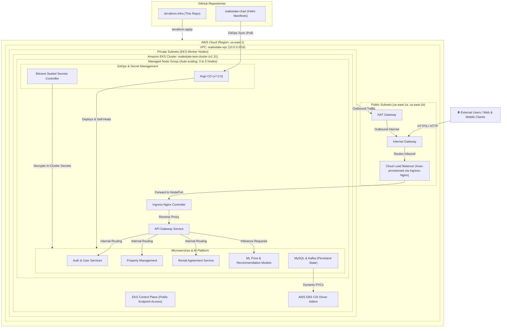

# Cloud-Native Infrastructure (AWS EKS & GitOps)


Production-grade, automated Infrastructure as Code (IaC) provisioning an Amazon EKS cluster with multi-AZ networking, automated GitOps continuous deployment (Argo CD), and encrypted secrets management.

---

## 🏛️ Architecture Overview

The infrastructure follows a multi-tier cloud architecture designed for high availability, security isolation, cost efficiency, and automated GitOps synchronization:



---

## ⚡ Key Architectural Highlights

### 1. High Availability & Network Isolation
- **Multi-AZ Footprint**: Deployed across `us-east-1a` and `us-east-1b` with discrete public and private CIDR blocks.
- **Private Worker Isolation**: Worker nodes run entirely in private subnets without public IPs, shielding microservices from direct internet exposure.
- **End-to-End Ingress Routing**: External traffic arrives through the Internet Gateway to a Cloud Load Balancer (dynamically managed by Ingress-Nginx in public subnets), which routes securely to the internal API Gateway and backend microservices.
- **Subnet Discovery Tags**: Subnets are tagged with `kubernetes.io/role/elb` and `kubernetes.io/role/internal-elb` so Kubernetes can automatically discover public subnets when creating LoadBalancer services.

### 2. Scalable Compute & Resource Optimization
- **Flexible Scalable Node Group**: Supports auto-scaling from **3 minimum** up to **5 maximum nodes** (default initial capacity: 3). Configured for cost-effective instance families (e.g., `m7i-flex.large` or SPOT instances) to provide optimal compute-to-price ratio for running 28+ pods concurrently.

### 3. Native Storage Orchestration
- **AWS EBS CSI Driver Addon**: Pre-installed as an EKS managed addon with IAM role integration (`AmazonEBSCSIDriverPolicy`), enabling dynamic PersistentVolumeClaim (PVC) provisioning for stateful workloads like Kafka, Zookeeper, and MySQL.

### 4. GitOps & Zero-Trust Secrets Bootstrap
- **Sealed Secrets Key Injection**: Automatically pre-injects your existing private key (`sealed-secrets-key.json`) into `kube-system` so that all encrypted secrets committed in Git can decrypt instantly upon deployment.
- **Automated Argo CD Bootstrap**: Provisions Argo CD via Helm (`v7.0.0`) and automatically applies the root Argo CD Application manifests (`argocd-app.yaml` / `argocd-staging-app.yaml`) to start pulling and syncing microservices directly from Git.

---

## 📂 Repository Structure

```
terraform-infra/
├── main.tf                 # Core VPC module and AWS EKS cluster configuration
├── variables.tf            # Parameter definitions with types, defaults, and descriptions
├── outputs.tf              # Exported cluster endpoints, network IDs, and connection commands
├── providers.tf            # AWS, Helm, and Kubernetes provider definitions
├── argocd.tf               # Sealed Secrets key injection & Argo CD Helm bootstrap
├── sealed-secrets-key.json # Private encryption key for Bitnami Sealed Secrets (gitignored)
└── README.md               # Infrastructure architecture and deployment guide
```

---

## ⚙️ Terraform Configuration Reference

### Inputs (`variables.tf`)

| Variable | Description | Type | Default |
| :--- | :--- | :---: | :--- |
| `aws_region` | AWS region to deploy infrastructure | `string` | `"us-east-1"` |
| `vpc_name` | Name of the VPC | `string` | `"realestate-vpc"` |
| `vpc_cidr` | CIDR block for the VPC | `string` | `"10.0.0.0/16"` |
| `availability_zones` | Availability zones for VPC subnets | `list(string)` | `["us-east-1a", "us-east-1b"]` |
| `private_subnets` | Private subnet CIDR blocks for worker nodes | `list(string)` | `["10.0.1.0/24", "10.0.2.0/24"]` |
| `public_subnets` | Public subnet CIDR blocks for load balancers | `list(string)` | `["10.0.101.0/24", "10.0.102.0/24"]` |
| `cluster_name` | Name of the Amazon EKS cluster | `string` | `"realestate-cluster"` |
| `cluster_version` | Kubernetes control plane version | `string` | `"1.31"` |
| `node_instance_types` | EC2 instance types for the managed node group | `list(string)` | `["m7i-flex.large"]` |
| `node_capacity_type` | Node capacity type (`ON_DEMAND` or `SPOT`) | `string` | `"ON_DEMAND"` |
| `node_min_size` | Minimum number of worker nodes | `number` | `3` |
| `node_max_size` | Maximum number of worker nodes | `number` | `5` |
| `node_desired_size` | Initial target number of worker nodes | `number` | `3` |

### Outputs (`outputs.tf`)

| Output | Description |
| :--- | :--- |
| `cluster_name` | Name of the deployed Amazon EKS cluster |
| `cluster_endpoint` | Endpoint URL for the Amazon EKS API server |
| `cluster_security_group_id` | Security group ID attached to the EKS control plane |
| `vpc_id` | ID of the VPC created for the cluster |
| `private_subnets` | List of private subnet IDs hosting worker nodes |
| `public_subnets` | List of public subnet IDs for external load balancers |
| `configure_kubectl` | One-liner command to authenticate `kubectl` with the cluster |

---

## 🚀 Deployment Guide

### Prerequisites
- **Terraform** (`>= 1.5.0`)
- **AWS CLI** (`v2`) configured with appropriate IAM deployment permissions
- **kubectl** (`>= 1.30`)
- **Helm** (`>= 3.10`)

### Step-by-Step Provisioning

1. **Clone the Repository**:
   ```bash
   git clone https://github.com/<your-username>/terraform-infra.git
   cd terraform-infra
   ```

2. **Ensure Sealed Secrets Key is Present**:
   Place your private decryption key in the repository root:
   ```bash
   # File: sealed-secrets-key.json (never commit to version control)
   ```

3. **Initialize Terraform**:
   ```bash
   terraform init
   ```

4. **Review Execution Plan**:
   ```bash
   terraform plan
   ```

5. **Deploy the Infrastructure**:
   ```bash
   terraform apply -auto-approve
   ```

6. **Connect `kubectl` to your new EKS Cluster**:
   Execute the output command generated by Terraform:
   ```bash
   aws eks update-kubeconfig --region us-east-1 --name realestate-cluster
   ```

7. **Verify Cluster & Pod Health**:
   ```bash
   # Check worker nodes (should show 3 Ready nodes)
   kubectl get nodes -o wide

   # Check Argo CD namespace
   kubectl get pods -n argocd

   # Check Sealed Secrets controller
   kubectl get pods -n kube-system -l app.kubernetes.io/name=sealed-secrets
   ```

---

## 🔒 Security Best Practices

- **Private Node Groups**: All workloads run in private subnets behind a NAT gateway.
- **Encrypted Secrets via Git**: Sensitive credentials are never committed as plaintext Kubernetes secrets. They are sealed using asymmetric cryptography (`kubeseal`) and decrypted only in-cluster.
- **IAM Roles for Service Accounts (IRSA)**: Fine-grained AWS IAM permissions attached directly to pods (e.g. EBS CSI Driver) rather than granting blanket EC2 instance profile access.
- **Admin Access Control**: `enable_cluster_creator_admin_permissions = true` ensures clean role binding for the cluster provisioner.

---

## 🧹 Teardown

To destroy all provisioned cloud resources and avoid ongoing AWS charges:

```bash
terraform destroy -auto-approve
```
